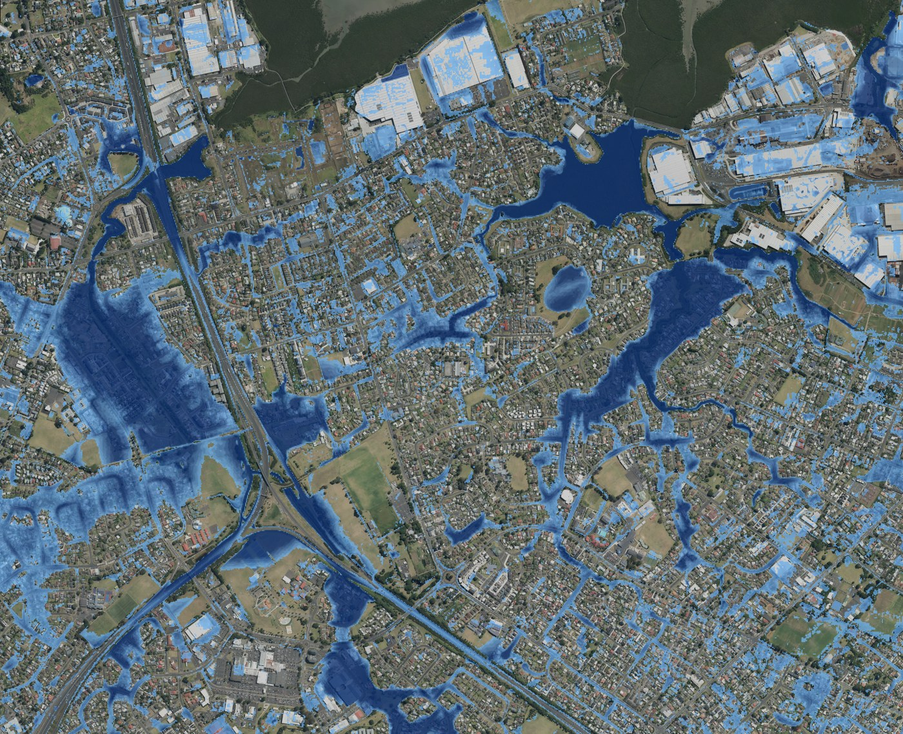

# Māngere, 27 January 2023: the storm replayed on open data

On 27 January 2023 Auckland Council's rain gauge at Greenwood Road, Māngere, recorded
**{{m9_rain_day_mm}} mm** in one day and **{{m9_rain_peak1h_mm}} mm in its worst hour**. This project
replays that storm over central Māngere to show how a suburb's drainage behaves when the rain is far
beyond what pipes are sized for.

**Result.** Street drains and culvert entrances took about **{{m9_drains_pct}}%** of the rain; the rest
moved over the ground. Of the open ground the model left under more than 10 cm of water,
**{{m9_wet_in_mapped_pct}}%** lies on the flood plains and overland flow paths Auckland Council has
already mapped, which cover {{m9_mapped_ha}} of {{m9_land_ha}} hectares of open ground.

The point is not that anything failed. Pipes are sized for frequent storms. Above that, the ground is
the second drainage system, which is why blue-green projects such as those on Harania and Te Ararata
creeks design for it.

## Method

| Part | What it is |
|---|---|
| Terrain | LINZ Auckland South LiDAR 2016–17, 1 m DEM, averaged to a 4 m grid ({{m9_model_land_km2}} km² modelled) |
| Rain | Auckland Council gauge 649704, Māngere @ Greenwood Road, tipping bucket, applied uniformly |
| Tide | LINZ predictions for Onehunga, held at the harbour edge |
| Buildings | OpenStreetMap footprints as high-roughness cells |
| Surface flow | 2D local-inertial shallow-water scheme (Bates et al. 2010; de Almeida et al. 2012) with θ-weighting, a Froude limiter and a reduced time step for the volcanic cones |
| Drains | Auckland Council catchpits as capacity-limited inlets ({{m9_grate_lps}} L/s each); culvert and pipe entrances at their pipe's full-bore capacity; every inlet group capped at its outfall pipe's full-bore capacity |
| Check | Council 1% AEP flood plains and overland flow paths |

The solver (`lisim.py`) and its self-checks (`test_lisim.py`) are in this repository. The checks:
still water stays still; water volume closes with rain, drains and a moving tide; a rained-on plane
reaches Manning normal depth; a steep crater fills to a level pond. The full run also closes its water
budget to a few parts per million.

## Limitations

- Drains are capacity limits, not a hydraulic pipe network: no surcharge, no backwater, no blockage.
  With {{sens_lo}} or {{sens_hi}} L/s per catchpit instead of {{m9_grate_lps}}, the drained share is
  {{range_lo}}% to {{range_hi}}%.
- No soil infiltration: after a wet January most soils were saturated, so this is an upper bound on
  runoff.
- One gauge, applied uniformly. Bare-earth terrain from 2016–17, before the current blue-green works.
- No open map of the flooding observed on the day exists, so the check is against the council's
  modelled flood plains, not against observation.

## What is not here

The data assembly, network processing, tide boundary and 3D rendering that produce the replay and
its video are not published. If you want to run this on your own catchment, get in touch:
[LinkedIn](https://www.linkedin.com/in/reza-moghaddam-11a81191).

## Data and credits

LINZ LiDAR and aerial imagery (CC BY 4.0). Auckland Council: rain gauge data (environmentauckland.org.nz),
stormwater network, flood plains and overland flow paths (Healthy Waters; indicative). OpenStreetMap
contributors (ODbL). None of the source data is redistributed here.

© 2026 Reza Moghaddam. All rights reserved. Shared for reading and discussion; ask before reuse.
